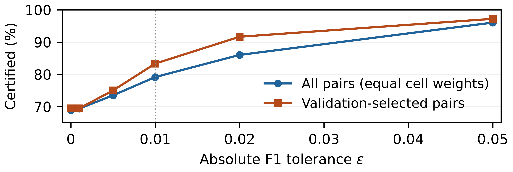

When Disagreement Labels Do Not Identify F1 Rankings
====================================================

**Exact F1 decisions from partially labeled batches.**

After labeling every item on which two classifiers disagree, can you choose
the better model? For F1, unknown labels on their agreements can still reverse
the answer. This repository computes the exact range of possible F1 differences
and tells you whether to **choose now or query more agreement labels**.

.. image:: https://github.com/roberto-fernandez-barrios/disagreement-f1-audits/actions/workflows/reproducibility.yml/badge.svg
   :target: https://github.com/roberto-fernandez-barrios/disagreement-f1-audits/actions/workflows/reproducibility.yml
   :alt: Reproducibility checks

`Read the six-page paper <paper/paper.pdf>`_ ·
`Download release 1.4.0 <https://github.com/roberto-fernandez-barrios/disagreement-f1-audits/releases/tag/v1.4.0>`_ ·
`Reproduce <docs/reproduction.rst>`_ ·
`Use your own predictions <docs/audit.rst>`_ ·
`Cite <CITATION.cff>`_

Roberto Fernández-Barrios, Iker Pastor-López, Asier González-Santocildes,
and Pablo García Bringas — Faculty of Engineering, University of Deusto.

What you can decide
-------------------

Supply two fixed binary prediction vectors, their observed labels, and
optionally the **exact number of positives** in the batch. Unknown labels are
explicitly ``null``. Every disagreement must already be labeled; agreements
can remain unknown. The audit returns sharp bounds ``[L, U]`` on
``F1(q) - F1(c)`` and distinguishes:

* A strict winner or an exact tie.
* A weak winner with zero loss.
* A choice guaranteed to lose at most a chosen absolute F1 tolerance.

The last choice is certified when ``L >= -epsilon`` or ``U <= epsilon``.
The guarantee holds for **every compatible completion of this batch**, assuming
correct observed labels. It is not a confidence interval or a population claim.

Certification immediately after disagreement labeling, with unknown prevalence
restricted to ``0 < P < n`` as in the original initial-information analysis.
Equal-cell means over **36 dependent cells**. At tolerance 0.01, 79.15% of all
pairs are certifiable; the corresponding value in the 28 reserved cells is
79.46%. Points are evaluated tolerances; connecting lines guide the eye.

Try the paper's counterexample
------------------------------

Python **3.13** is the tested runtime. Create an isolated environment::

    git clone https://github.com/roberto-fernandez-barrios/disagreement-f1-audits.git
    cd disagreement-f1-audits
    python -m venv .venv

On Linux or macOS::

    .venv/bin/python -m pip install -r requirements.lock
    .venv/bin/python tools/manage.py demo

On Windows PowerShell::

    .venv/Scripts/python.exe -m pip install -r requirements.lock
    .venv/Scripts/python.exe tools/manage.py demo

The `ten-item example <examples/ten_items.json>`_ reveals just three labels and
supplies the exact positive count ``P=4``. The expected output includes::

    paired_interval: [-2/35, 1/5]
    minimum_worst_case_regret: 2/35
    action: query_agreements
    chosen_model: null

Thus neither choice is certified at tolerance 0.01. The program does not load
hidden agreement labels. The `input guide <docs/audit.rst>`_ explains how to
audit your own pair and update the decision as labels arrive.

Repository layout
-----------------

The public root contains the standard README, license, citation and environment
files. Research material is grouped by purpose::

    src/              Exact F1 interval and decision code
    tools/            Public audit and reproducibility commands
    examples/         Runnable input example
    data/             Frozen predictions, validation and control inputs
    results/          Numerical results and the tolerance figure
    paper/            Six-page PDF, LaTeX sources and references
    tests/            Interface and scientific verification tests
    docs/             User guides, evidence map, provenance and change log
    reproducibility/  Protocols, analysis scripts, manifests and run records

`How the paths are preserved <reproducibility/README.rst>`_ explains the exact
mapping to historical execution records. AI-review reports remain available
in the previous version's archive; they are not part of this release's file tree.

Verify, reproduce, build
------------------------

Below, ``python`` denotes the interpreter in the environment above. Each command
creates a separate ``.work/`` directory and prints its report location.
**The reference results and delivered PDF are never overwritten.**

.. list-table:: Public commands
   :header-rows: 1
   :widths: 44 56

   * - Command
     - Purpose
   * - ``python tools/manage.py verify``
     - Check integrity, exact mathematical tests, interface tests and PDF format.
   * - ``python tools/manage.py reproduce``
     - Reconstruct the V4 zero-loss control, tolerance curve and table.
   * - ``python tools/manage.py reproduce --scope all``
     - Also rerun the original pilot, reserved-cell analysis and V3 campaign.
   * - ``python tools/manage.py build``
     - Compile a separate six-page PDF with existing MiKTeX or TeX Live.
   * - ``python tools/manage.py package``
     - Build a deterministic ZIP and report its SHA-256.

The released inputs are sufficient: **no training, original feature tables,
GPU, QPU, account or network access is needed after dependency installation**.
PDF compilation alone requires a separate TeX installation.
See `reproduction details <docs/reproduction.rst>`_ for scope, outputs, environment,
runtime measurements, and the distinction between numeric and binary identity.

What the evidence shows
-----------------------

The benchmark reuses 3,200 frozen pairs across 36 dependent cells, with three
query policies and 32 orders. Under the magnitude policy, equal-cell mean
**total labels**, including the initial disagreements, are:

.. list-table:: Common cohorts; 500 items in each batch
   :header-rows: 1
   :widths: 34 22 22 22

   * - Comparator design
     - Strict winner / exact tie
     - Zero-loss choice
     - Loss at most 0.01
   * - All pairs
     - 121.16
     - 120.92
     - 74.59
   * - Validation-selected pair
     - 92.57
     - 92.25
     - 40.29

Most of the saving comes from allowing a small positive loss. Merely permitting
ties changes little. These are observed policy costs, not optimal lower bounds.
The `evidence map <docs/evidence.rst>`_ links the paper's claims, figure and table
to their exact inputs, outputs and commands.

Scope and provenance
--------------------

This is an explicit specialization of the TDC and Polo partial-identification
frameworks. Its contribution is the disagreement-first audit and its decision
consequences. The work is retrospective; the eight-cell pilot and 28-cell
analytical holdout do not constitute a new prospective evaluation. Cells, pairs
and seeds share data. F1 means positive-class binary F1, with ``0/0=0``.

`Provenance and limitations <docs/provenance.rst>`_ distinguishes the
`TDC theoretical preprint v1 <https://arxiv.org/abs/2610.00080v1>`_, the reused
`TDC prediction artifact 1.1.6 <https://doi.org/10.5281/zenodo.21776862>`_, and
this repository. Original protocols, scientific files and historical releases
remain intact. Code, frozen inputs, results, manuscript sources and the PDF are
included; raw feature tables and private portal information are not.

Availability, citation and status
---------------------------------

Repository release **1.4.0** contains manuscript **V5**, with corrected
literature positioning and data attribution. Numerical science remains the
frozen ``v1.1.0`` snapshot. Use the
versioned GitHub release above for access and ``CITATION.cff`` for citation.
Version-specific archive: https://doi.org/10.5281/zenodo.23647323.
The previously empty reservation is used for 1.4.0; the published v1.0.0
record and all earlier GitHub releases are preserved.

The paper is prepared for the **general track of ESANN 2027**; it is not yet
submitted or accepted. `Release history <docs/changelog.rst>`_ records the changes.

Software and derived results: `BSD-3-Clause <LICENSE>`_. Manuscript: CC BY 4.0.
The ESANN template retains its original license; see
`license and data notices <docs/licenses.rst>`_. Codex assisted the research,
code, analysis and writing; Claude Fable 5.1, xhigh, provided independent AI
review of V4 and the V5 literature correction. This AI review is distinct from conference peer review. The authors
retain responsibility. No specific funding.

For a reproducible issue or a proposed improvement, see
`contribution guidance <.github/CONTRIBUTING.rst>`_.
